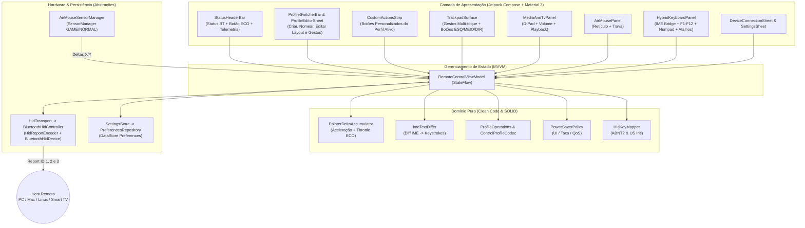
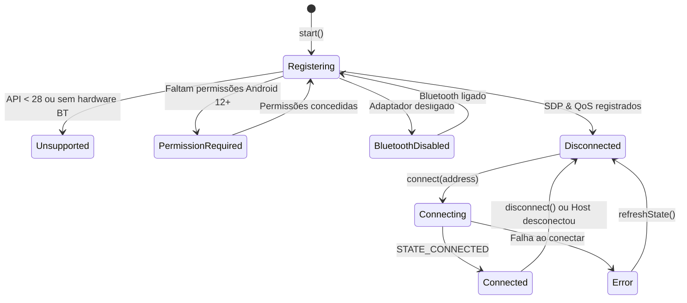
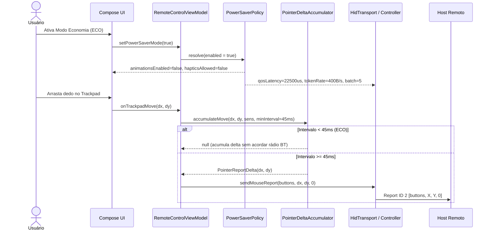

# Smarties Controller — Controle Bluetooth HID (Mouse e Teclado)

> **Namespace do Pacote:** `br.com.smarttarget.android.controller`  
> **Application ID:** `com.aistudio.smartiescontroller.k7m2px`  
> **Resumo:** O **Smarties Controller** transforma o smartphone Android em um periférico **Bluetooth HID (Human Interface Device)** nativo de baixa latência, emulando mouse/trackpad multi-toque, teclado híbrido (ABNT2 / US Internacional), controle de mídia/Smart TV e Air Mouse via giroscópio em PCs, notebooks, tablets e Smart TVs sem exigir nenhum software servidor no dispositivo remoto.

---

## Decisões Confirmadas e Padrões Adotados

- **Identidade & Pacote:** Nome oficial **Smarties Controller** e namespace `br.com.smarttarget.android.controller`.
- **Perfil de Controle Principal:** Trackpad amplo como superfície dominante, teclado híbrido retrátil e controles rápidos de mídia/atalhos.
- **Perfis de Controle Personalizáveis:** Criação, nomeação, edição, duplicação e alternância rápida de perfis (*Produtividade*, *Jogos / Ação*, *Smart TV & Sofá* e perfis do usuário) com layout customizado de botões de ação, modo padrão, layout de teclado, sensibilidade, opções de gestos e modo canhoto.
- **Modo Economia de Energia (ECO):** Desativa animações da UI e brilhos no `Canvas`, reduz a frequência de envio de relatórios HID (de ~83 Hz para ~22 Hz) e amostragem do giroscópio (`SENSOR_DELAY_NORMAL`), suspende vibrações hápticas e otimiza os parâmetros de QoS Bluetooth (`latency` e `tokenRate`).
- **Entrada de Teclado Híbrido:** Digitação pelo teclado nativo (IME) convertida para scancodes USB/HID (`ABNT2` e `US Internacional`), combinada com modificadores traváveis (`CTRL`, `ALT`, `SHIFT`, `WIN`), `F1–F12`, setas, `Numpad` e atalhos rápidos.
- **Identidade Visual:** Tema escuro utilitário de alto contraste (*Dark Tech*), otimizado para uso noturno ou com Smart TVs e notebooks.

---

## 1. Visão Geral e Conceito Central

- **O que o aplicativo faz:** Registra o smartphone como um dispositivo Bluetooth HID composto (Teclado + Mouse + Consumer Control) via API nativa `BluetoothHidDevice`. Após o pareamento Bluetooth padrão com Windows, macOS, Linux, ChromeOS, Android TV ou iPadOS, o usuário move o cursor, executa gestos multi-toque, digita textos acentuados, alterna perfis específicos para trabalho/jogos/TV e economiza bateria com o modo ECO.
- **Público-alvo:** Usuários controlando notebooks ligados à TV, apresentações, media centers, jogos casuais ou setups sem mouse físico.
- **Diferencial:** Comunicação direta pelo protocolo padrão Bluetooth HID — zero dependência de Wi-Fi ou agentes instalados no host remoto.

---

## 2. Experiência do Usuário, Design Visual e Fluxos

### Fluxos Principais

1. **Inicialização, Permissões e Status Bluetooth:** Cabeçalho exibe estado da conexão HID, contador de relatórios (`HID #N`), botão rápido **ECO**, seletor de dispositivos e ajustes.
2. **Pareamento e Seleção de Dispositivo:** Sheet modal com banner ilustrativo, solicitação de permissões Android 12+ (`BLUETOOTH_CONNECT`, `BLUETOOTH_SCAN`, `BLUETOOTH_ADVERTISE`), modo visível (`ACTION_REQUEST_DISCOVERABLE`) e lista de dispositivos pareados.
3. **Perfis Personalizáveis (`ProfileSwitcherBar` + `ProfileEditorSheet`):** Alternância com 1 toque entre perfis salvos e editor completo para configurar nome, categoria, modo inicial, layout de teclado, sensibilidades, gestos, inversão de botões e lista de botões personalizados (`CustomActionsStrip`).
4. **Superfícies de Controle:**
   - **Trackpad:** Movimento relativo com aceleração, toque para clique esquerdo, 2 dedos para clique direito/scroll, *double-tap & drag* e botões `ESQ`/`MEIO`/`DIR` (com inversão opcional para canhotos).
   - **Mídia & TV:** D-Pad direcional, `OK`, `Voltar`, `Início`, `Buscar`, volume e transporte de mídia.
   - **Air Mouse:** Controle espacial via `Sensor.TYPE_GYROSCOPE` com zona morta, retículo visual e botão de calibração/trava.
5. **Teclado Híbrido Retrátil:** Barra de modificadores traváveis, ponte IME em tempo real, `F1–F12`, teclas de navegação, `Numpad` e atalhos rápidos.

### Identidade Visual & Design System

| Token / Elemento | Valor / Definição |
| :--- | :--- |
| **Fundo (`background`)** | Grafite profundo `#0B0E14` |
| **Superfícies (`surface` / `surfaceContainer`)** | Ardósia escura `#141923` / `#1C2331` com borda `#2A3447` |
| **Acento Primário (`primary`)** | Ciano elétrico `#38BDF8` |
| **Acento Secundário (`secondary`)** | Índigo técnico `#818CF8` |
| **Conectado / ECO (`tertiary`)** | Verde esmeralda `#34D399` |
| **Erro (`error`)** | Coral alerta `#F87171` |
| **Fontes Bundled (`res/font/`)** | *Space Grotesk* (títulos), *JetBrains Mono* (teclas/telemetria), *Inter* (corpo) |
| **Layout Adaptativo** | *Edge-to-Edge* (`WindowInsets.safeDrawing`), vertical em `Compact` e duas colunas em `>= 720.dp` |

---

## 3. Decisões Técnicas, Clean Code, SOLID e Trade-Offs

- **Perfil Nativo `BluetoothHidDevice` vs. Servidor Proprietário:** Adotado `BluetoothHidDevice` (API 28+) com guarda de versão sobre `minSdk 24` para compatibilidade universal sem software no PC.
- **Princípios SOLID Aplicados:**
  - **Single Responsibility (SRP):** `HidReportEncoder` (codificação de bytes HID), `PointerDeltaAccumulator` (sub-pixels, aceleração e throttle), `ImeTextDiffer` (diff Unicode → keystrokes), `ProfileOperations` (regras de CRUD de perfis) e `PowerSaverPolicy` (parâmetros do modo ECO).
  - **Dependency Inversion (DIP) & Interface Segregation (ISP):** `HidTransport` abstrai `BluetoothHidController`; `SettingsStore` abstrai `PreferencesRepository`.
- **Persistência Local (DataStore Preferences):** Perfis (`ControlProfileCodec`) e preferência de Economia de Energia persistidos localmente sem dependência de banco SQL ou nuvem.

---

## 4. Diagramas de Arquitetura e Fluxos (Mermaid / Obsidian)

### Arquitetura de Componentes e Camadas

### Máquina de Estados da Conexão Bluetooth HID

### Fluxo de Relatórios HID e Modo Economia de Energia (ECO)

---

## 5. Especificação dos Descritores HID e Modelos de Dados

### Descritor USB HID Composto

| Report ID | Perfil | Tamanho | Estrutura dos Bytes |
| :---: | :--- | :---: | :--- |
| **`1`** | Teclado Padrão (Usage `0x06`) | 8 bytes | `[Modificadores] [0x00] [Key1] [Key2] [Key3] [Key4] [Key5] [Key6]` |
| **`2`** | Mouse Relativo (Usage `0x02`) | 4 bytes | `[Botões (3 bits)] [Delta X (-127..127)] [Delta Y (-127..127)] [Wheel (-127..127)]` |
| **`3`** | Consumer Control (Usage `0x01`) | 2 bytes | Bitmask 10 bits: Play/Pause, Next, Prev, Stop, Vol+, Vol-, Mute, Home, Back, Search |

### Comparativo: Modo Normal vs. Modo Economia de Energia (ECO)

| Parâmetro | Modo Padrão | Modo ECO |
| :--- | :---: | :---: |
| **Animações da UI (`animationsEnabled`)** | Ativadas (transitions & Canvas glow) | Desativadas (`tween(0)` / `EnterTransition.None`) |
| **Vibração Háptica (`hapticsAllowed`)** | Permitida conforme perfil | Suspensa para economizar bateria |
| **Taxa de Envio HID (`hidReportMinIntervalMs`)** | `12 ms` (~83 Hz) | `45 ms` (~22 Hz, com coalescência de deltas) |
| **Amostragem do Giroscópio (`SensorManager`)** | `SENSOR_DELAY_GAME` | `SENSOR_DELAY_NORMAL` (UI throttled a `120 ms`) |
| **Telemetria na UI (`telemetryUiBatchSize`)** | A cada 1 pacote | A cada 5 pacotes |
| **QoS Bluetooth (`tokenRate` / `latency`)** | `800 B/s` • `11.25 ms` | `400 B/s` • `22.50 ms` |

---

## 6. Histórico Incremental de Versões

| Versão | Data | Resumo das Alterações |
| :--- | :--- | :--- |
| **v0.1.0** | 2026-11-19 | Definição inicial da arquitetura Bluetooth HID (`BluetoothHidDevice`), tema *Dark Tech*, trackpad multi-toque, teclado híbrido e controles Mídia/Air Mouse. |
| **v0.2.0** | 2026-11-19 | Atualização da identidade e nome oficial do aplicativo para **Smarties Controller**. |
| **v0.3.0** | 2026-11-19 | Implementação inicial da camada HID/UI/DataStore, testes unitários/Robolectric e geração de `README.md` com diagramas Mermaid para Obsidian. |
| **v0.4.0** | 2026-11-19 | Migração completa do namespace do pacote para `br.com.smarttarget.android.controller` em código-fonte, testes e documentação. |
| **v0.5.0** | 2026-11-19 | Refatoração Clean Code & SOLID (`HidTransport`, `SettingsStore`, `HidReportEncoder`, `PointerDeltaAccumulator`, `ImeTextDiffer`, `ProfileOperations`, `PowerSaverPolicy`), adição de **Perfis de Controle Personalizáveis**, **Modo Economia de Energia (ECO)**, suíte de testes unitários/Robolectric e consolidação integral do planejamento neste `README.md`. |
