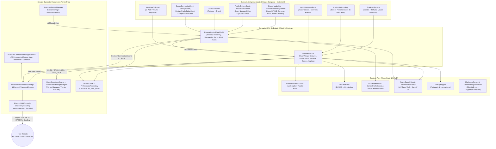
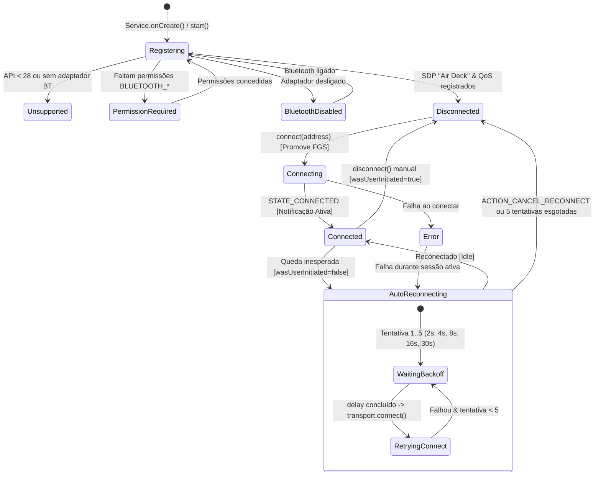
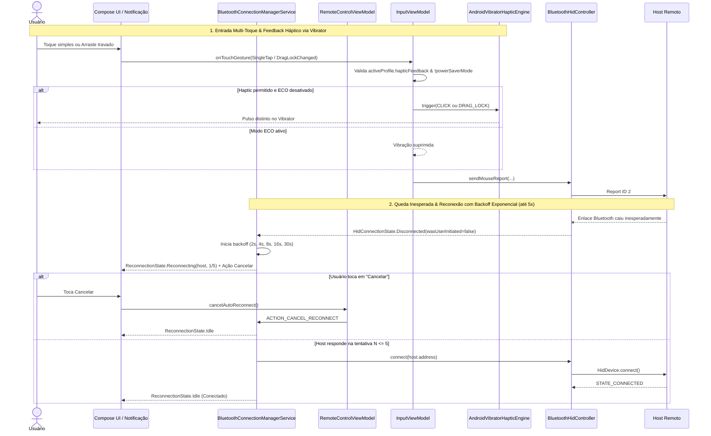

# Air Deck – Virtual Hardware

> **Aplicativo:** `Air Deck`  
> **Namespace do Pacote:** `br.com.smarttarget.android.airdeck`  
> **Application ID:** `com.aistudio.smartiescontroller.k7m2px`  
> **Resumo:** O **Air Deck** transforma o smartphone Android em um periférico **Bluetooth HID (Human Interface Device)** nativo de baixa latência, emulando mouse/trackpad multi-toque, teclado híbrido (**Português** `ABNT2` / **Internacional** `US_INTL`), controle de mídia/Smart TV e Air Mouse via giroscópio em PCs, notebooks, tablets e Smart TVs sem exigir nenhum software servidor no dispositivo remoto.

---

## Decisões Confirmadas e Padrões Adotados

- **Identidade & Pacote:** Nome oficial **Air Deck** e namespace `br.com.smarttarget.android.airdeck` (sincronizado entre AndroidManifest, `strings.xml`, `build.gradle.kts`, `settings.gradle.kts` e `metadata.json`).
- **Perfil de Controle Principal & Barra de Modos:** Trackpad amplo como superfície dominante, painel Mídia & TV, Air Mouse e teclado híbrido retrátil acionados por barra compacta de ícones com tooltips (**Mouse**, **Mídia**, **Air** e **Teclado** via Material 3 `TooltipBox` + `PlainTooltip`).
- **`InputViewModel` Dedicado à Entrada + Gestos Personalizados + Háptica via `Vibrator`:** Traduz eventos imutáveis de toque multi-toque (`TouchGestureEvent`, incluindo movimento, toque simples/duplo, rolagem, *pinch-to-zoom* via `Ctrl+Scroll` e **deslizes personalizados** `SwipeGesture`), deltas de giroscópio (`onAirMouseDelta`) e digitação (`KeyboardInputEvent`) em pacotes USB/HID via `HidReportSender`; além de **editar, criar e salvar perfis de gestos personalizados** (`SwipeGesturePattern` → `NavigationAction`) diretamente no `SettingsStore` e disparar padrões táteis distintos (`CLICK`, `DRAG_LOCK`, `STEP_TICK`) pelo serviço de sistema `Vibrator`/`VibratorManager` (`AndroidVibratorHapticEngine`).
- **`BluetoothConnectionManagerService` (*Connected Device FGS* + Reconexão Automática):** Serviço vinculado e capaz de operar em primeiro plano (`foregroundServiceType="connectedDevice"`) que centraliza descoberta de dispositivos próximos (`ACTION_FOUND` / RSSI), pareamento (*bonding* / `ACTION_BOND_STATE_CHANGED`), gerenciamento de estado `BluetoothHidDevice`, notificação persistente e **reconexão automática com *backoff* exponencial de até 5 tentativas** (`2s → 4s → 8s → 16s → 30s`) em quedas inesperadas, com status ao vivo e botão **Cancelar** na notificação e na UI.
- **Perfis de Controle Personalizáveis:** Criação, nomeação, edição, duplicação e alternância rápida de perfis builtin (**Geral**, **Jogos**, **TV**) e perfis do usuário com layout customizado de botões de ação, modo padrão, layout de teclado, sensibilidade, opções de gestos e modo canhoto.
- **Aviso de Bluetooth Desligado:** Banner inline padronizado com a mensagem `"Ative o bluetooth para conectar"`.
- **Modo Economia de Energia (ECO):** Desativa animações da UI e brilhos no `Canvas`, desativa **toda** emissão de vibração do `Vibrator`, reduz a frequência de envio de relatórios HID (de ~83 Hz para ~22 Hz) e amostragem do giroscópio (`SENSOR_DELAY_NORMAL`), e otimiza os parâmetros de QoS Bluetooth (`latency` e `tokenRate`).
- **Entrada de Teclado Híbrido:** Digitação pelo teclado nativo (IME) convertida para scancodes USB/HID nos layouts **Português** (`ABNT2`) e **Internacional** (`US_INTL`), configuráveis em `"Layout do Teclado"`, combinada com modificadores traváveis (`CTRL`, `ALT`, `SHIFT`, `WIN`), `F1–F12`, setas, `Numpad` e atalhos rápidos.
- **Ajuda Integrada em Markdown + Mermaid:** Botão de ícone **Ajuda** ao lado de **Ajustes** no cabeçalho (`StatusHeaderBar`) abrindo o leitor nativo (`HelpReadmeSheet`) que renderiza o `README.md` completo com tabelas, citações, listas, blocos de código e renderização vetorial dos diagramas Mermaid (`flowchart`, `stateDiagram-v2` e `sequenceDiagram`).
- **Identidade Visual:** Tema escuro utilitário de alto contraste (*Dark Tech*), otimizado para uso noturno ou com Smart TVs e notebooks.

---

## 1. Visão Geral e Conceito Central

- **O que o aplicativo faz:** Registra o smartphone como um dispositivo Bluetooth HID composto (Teclado + Mouse + Consumer Control) via API nativa `BluetoothHidDevice`. Orquestra descoberta, pareamento e reconexão automática após quedas inesperadas no `BluetoothConnectionManagerService`, fornece resposta tátil sob medida pelo `Vibrator` em cada interação e suporta perfis personalizáveis e modo ECO.
- **Público-alvo e cenários de uso:** Usuários controlando notebooks ligados à TV, apresentações, media centers (HTPC/Android TV), sessões de jogos casuais ou setups sem mouse físico.
- **Principal diferencial:** Comunicação direta pelo protocolo padrão Bluetooth HID — zero dependência de rede Wi-Fi ou agentes instalados no host remoto.

---

## 2. Experiência do Usuário, Design Visual e Fluxos

### Fluxos Principais do Usuário

1. **Inicialização, Permissões e Status Bluetooth:** Cabeçalho compacto exibe estado da conexão HID (ou contagem de reconexão `Reconectando (X/5)…`), contador de relatórios (`HID #N`), botão rápido **ECO**, seletor de dispositivos e ajustes.
2. **Descoberta, Pareamento e Reconexão Automática:** O modal `DeviceConnectionSheet` interage com o `BluetoothConnectionManagerService` para conceder permissões Android 12+, procurar dispositivos próximos com RSSI, parear (*bonding*) e conectar ao perfil HID. Em quedas inesperadas, tanto o banner principal da tela quanto o cartão da notificação/modal exibem a tentativa atual (`1..5`) com botão **Cancelar**.
3. **Perfis Personalizáveis (`ProfileSwitcherBar` + `ProfileEditorSheet`):** Alternância com 1 toque entre perfis salvos e editor completo para configurar nome, categoria, modo inicial, layout de teclado, sensibilidades, háptica, gestos, inversão de botões e botões personalizados (`CustomActionsStrip`).
4. **Superfícies de Controle (`InputViewModel`):**
   - **Trackpad:** Movimento relativo com aceleração, toque para clique esquerdo, 2 dedos para clique direito/scroll, pinça para zoom (`Ctrl+Scroll`), *double-tap & drag* e **silhueta única de mouse em drawable** (`ic_mouse_zone_left`, `ic_mouse_zone_middle`, `ic_mouse_zone_right`) dividida em três zonas com roda central, sem texto inline (tooltips Material 3), destaque ativo em ciano e posições fixas no modo canhoto — com pulso tátil distinto para cliques, passos de rolagem/zoom e trava de arraste.
   - **Mídia & TV:** D-Pad direcional, `OK`, `Voltar`, `Início`, `Buscar`, volume e transporte de mídia.
   - **Air Mouse:** Controle espacial via `Sensor.TYPE_GYROSCOPE` com zona morta, retículo visual, calibração/trava e repasse de deltas para `InputViewModel`.
5. **Teclado Híbrido Retrátil:** Abas **Teclado**, **Controle** e **Atalhos**, barra de modificadores traváveis, ponte IME em tempo real, `F1–F12`, teclas de navegação, `Numpad` e atalhos rápidos.

### Identidade Visual & Design System

| Token / Elemento | Valor / Definição |
| :--- | :--- |
| **Fundo (`background`)** | Grafite profundo `#0B0E14` |
| **Superfícies (`surface` / `surfaceContainer`)** | Ardósia escura `#141923` / `#1C2331` com borda `#2A3447` |
| **Acento Primário (`primary`)** | Ciano elétrico `#38BDF8` |
| **Acento Secundário (`secondary`)** | Índigo técnico `#818CF8` |
| **Conectado / ECO (`tertiary`)** | Verde esmeralda `#34D399` |
| **Reconectando / Aviso (`AmberWarning`)** | Âmbar alerta `#FBBF24` |
| **Erro (`error`)** | Coral alerta `#F87171` |
| **Fontes Bundled (`res/font/`)** | *Space Grotesk* (títulos), *JetBrains Mono* (teclas/telemetria), *Inter* (corpo) |
| **Layout Adaptativo & Safe Areas** | `enableEdgeToEdge()`, `WindowInsets.safeDrawing`, vertical em `Compact` e duas colunas em `>= 720.dp` |

---

## 3. Decisões Técnicas, Clean Code, SOLID e Trade-Offs

- **Perfil Nativo `BluetoothHidDevice` vs. Servidor Proprietário:** Adotado `BluetoothHidDevice` (API 28+) com guarda de versão sobre `minSdk 24` para compatibilidade universal sem software no PC.
- **Princípios SOLID Aplicados:**
  - **Single Responsibility (SRP):**
    - `InputViewModel`: processamento puro de entrada (`TouchGestureEvent`, `KeyboardInputEvent`, `CustomActionButton`, Air Mouse -> relatórios HID + disparo de `HapticPattern`).
    - `RemoteControlViewModel`: gerenciamento de sessão Bluetooth, descoberta, pareamento, perfis, ECO, exibição de `ReconnectionState` e giroscópio.
    - `BluetoothConnectionManagerService`: descoberta, *bonding*, estado HID, reconexão automática com *backoff* exponencial e notificação foreground `connectedDevice`.
    - Domínio puro testável na JVM: `HidReportEncoder`, `PointerDeltaAccumulator`, `ImeTextDiffer`, `ProfileOperations`, `PowerSaverPolicy` e `ReconnectionPolicy`.
  - **Interface Segregation (ISP) & Dependency Inversion (DIP):**
    - `HidTransport` é segregado em `HidReportSender` (`InputViewModel`) e `BluetoothConnectionControl` (`RemoteControlViewModel` / `Service`).
    - `HapticFeedbackEngine` abstrai `AndroidVibratorHapticEngine` (`Vibrator` / `VibratorManager`), permitindo testes determinísticos na JVM sem acoplamento ao framework Android.
    - `SettingsStore` abstrai `PreferencesRepository`.
  - **Prevenção de Dupla Vibração:** Vibrações para cliques, gestos, teclas e mídia foram removidas das `Views` e unificadas no `InputViewModel`.
- **Persistência Local (DataStore Preferences):** Perfis (`ControlProfileCodec`) e preferência de Economia de Energia persistidos localmente em `air_deck_prefs` sem dependência de banco SQL ou nuvem.

---

## 4. Diagramas de Arquitetura e Fluxos (Mermaid / Obsidian)

### Arquitetura de Componentes, ViewModels, Háptica e Serviço Bluetooth

### Máquina de Estados da Conexão, Descoberta, Pareamento e Reconexão Automática

### Sequência: Entrada Háptica (`Vibrator`), Modo ECO e Reconexão Automática Cancelável

---

## 5. Especificação dos Descritores HID e Parâmetros

### Descritor USB HID Composto

| Report ID | Perfil | Tamanho | Estrutura dos Bytes |
| :---: | :--- | :---: | :--- |
| **`1`** | Teclado Padrão (Usage `0x06`) | 8 bytes | `[Modificadores] [0x00] [Key1] [Key2] [Key3] [Key4] [Key5] [Key6]` |
| **`2`** | Mouse Relativo (Usage `0x02`) | 4 bytes | `[Botões (3 bits)] [Delta X (-127..127)] [Delta Y (-127..127)] [Wheel (-127..127)]` |
| **`3`** | Consumer Control (Usage `0x01`) | 2 bytes | Bitmask 10 bits: Play/Pause, Next, Prev, Stop, Vol+, Vol-, Mute, Home, Back, Search |

### Padrões Hápticos (`Vibrator` via `InputViewModel`)

| Padrão | Duração / Forma de Onda | Eventos Associados |
| :--- | :--- | :--- |
| **`CLICK`** | Pulso único `14 ms` (amplitude `150`) | Toque simples, clique direito, clique do meio, zonas da silhueta do mouse, botões customizados e ações de Mídia/TV |
| **`DRAG_LOCK`** | Pulso duplo `[0, 14, 28, 22] ms` (amplitudes `150 → 215`) | Ativação/desativação de arraste travado (*Drag Lock*) e trava de modificadores (*Sticky Lock*) |
| **`STEP_TICK`** | Micro-pulso `7 ms` (amplitude `90`, cooldown `65 ms`) | Passos de rolagem com 2 dedos, gatilhos de pinça (`Zoom +`/`Zoom -`), teclas especiais, modificadores e atalhos |

### Comparativo: Modo Normal vs. Modo Economia de Energia (ECO)

| Parâmetro | Modo Padrão | Modo ECO |
| :--- | :---: | :---: |
| **Animações da UI (`animationsEnabled`)** | Ativadas (transitions & Canvas glow) | Desativadas (`tween(0)` / `EnterTransition.None`) |
| **Vibração Háptica (`Vibrator` / `hapticsAllowed`)** | Ativa conforme perfil (`CLICK`, `DRAG_LOCK`, `STEP_TICK`) | Completamente desativada para preservar bateria |
| **Taxa de Envio HID (`hidReportMinIntervalMs`)** | `12 ms` (~83 Hz) | `45 ms` (~22 Hz, com coalescência de deltas) |
| **Amostragem do Giroscópio (`SensorManager`)** | `SENSOR_DELAY_GAME` | `SENSOR_DELAY_NORMAL` (UI throttled a `120 ms`) |
| **Telemetria na UI (`telemetryUiBatchSize`)** | A cada 1 pacote | A cada 5 pacotes |
| **QoS Bluetooth (`tokenRate` / `latency`)** | `800 B/s` • `11.25 ms` | `400 B/s` • `22.50 ms` |

---

## 6. Histórico Incremental de Versões

| Versão | Data | Resumo das Alterações |
| :--- | :--- | :--- |
| **v0.1.0** | 2026-11-19 | Definição inicial da arquitetura Bluetooth HID (`BluetoothHidDevice`), tema *Dark Tech*, trackpad multi-toque, teclado híbrido e controles Mídia/Air Mouse. |
| **v0.2.0** | 2026-11-19 | Atualização da identidade e nome oficial do aplicativo para **Smarties Controller**. |
| **v0.3.0** | 2026-11-19 | Implementação inicial da camada HID/UI/DataStore, testes unitários/Robolectric e geração de `README.md` com diagramas Mermaid para Obsidian. |
| **v0.4.0** | 2026-11-19 | Migração completa do namespace do pacote para `br.com.smarttarget.android.controller` em código-fonte, testes e documentação. |
| **v0.5.0** | 2026-11-19 | Refatoração Clean Code & SOLID (`HidTransport`, `SettingsStore`, `HidReportEncoder`, `PointerDeltaAccumulator`, `ImeTextDiffer`, `ProfileOperations`, `PowerSaverPolicy`), adição de **Perfis de Controle Personalizáveis**, **Modo Economia de Energia (ECO)**, suíte de testes unitários/Robolectric e consolidação integral do planejamento neste `README.md`. |
| **v0.6.0** | 2026-11-19 | Criação do `InputViewModel` para tradução de `TouchGestureEvent` (incl. *pinch-to-zoom*) e `KeyboardInputEvent` em relatórios HID, segregação `HidReportSender` / `BluetoothConnectionControl`, `ControllerViewModelFactory` e testes unitários em `InputViewModelTest`. |
| **v0.7.0** | 2026-11-19 | Criação do `BluetoothConnectionManagerService` (*bound + foreground connectedDevice*) com descoberta ativa de dispositivos próximos (RSSI), pareamento (*bonding* / `ACTION_BOND_STATE_CHANGED`), notificação persistente com ação de desconectar, `BluetoothTransportRegistry`, integração com `DeviceConnectionSheet` e testes Robolectric em `BluetoothConnectionManagerServiceTest`. |
| **v0.8.0** | 2026-11-19 | Rebranding completo para **Air Deck** e migração do namespace do pacote para `br.com.smarttarget.android.airdeck` em código-fonte, recursos, manifesto, testes, artefato de planejamento e `README.md`. |
| **v0.9.0** | 2026-11-19 | **Feedback háptico via `Vibrator` & Reconexão Automática:** Padrões táteis distintos (`CLICK`, `DRAG_LOCK`, `STEP_TICK`) no `InputViewModel` via `AndroidVibratorHapticEngine` (`HapticFeedbackEngine`, permissão `VIBRATE`, bloqueio total em ECO e prevenção de dupla vibração nas Views); e reconexão automática no `BluetoothConnectionManagerService` com distinção de queda inesperada (`wasUserInitiated`), *backoff* exponencial de até 5 tentativas (`2s→4s→8s→16s→30s`), status ao vivo e botão **Cancelar** na notificação, banner inline e `DeviceConnectionSheet`, com testes em `InputViewModelTest`, `AndroidVibratorHapticEngineTest`, `BluetoothConnectionManagerServiceTest` e `ExampleRobolectricTest`. |
| **v0.9.1** | 2026-11-19 | Padronização dos títulos dos documentos: artefato de planejamento como **Air Deck – Planejamento** e documentação raiz como **Air Deck – Virtual Hardware**. |
| **v0.9.2** | 2026-11-19 | Renomeação dos perfis builtin para **Geral**, **Jogos** e **TV** (`ProfilePresets`) e atualização do texto do banner de Bluetooth desligado para `"Ative o bluetooth para conectar"`. |
| **v0.9.3** | 2026-11-19 | Renomeação dos rótulos de `KeyboardLayout` para **Português** (`ABNT2`) e **Internacional** (`US_INTL`), simplificação do título da seção em `SettingsSheet` para `"Layout do Teclado"` e atualização da suíte Robolectric (`ExampleRobolectricTest`). |
| **v0.9.4** | 2026-11-19 | Conversão dos botões **Mouse**, **Mídia**, **Air** e **Teclado** (`ModeSwitcherBar` / `ModeChip`) para exibição exclusiva de ícones com rótulo em tooltip (`TooltipBox` + `PlainTooltip`) e validação em `ExampleRobolectricTest`. |
| **v0.9.5** | 2026-11-19 | Renomeação das abas de teclado `"Teclado IME"` → **"Teclado"** e `"F1–F12 & Num"` → **"Controle"**; e remodelagem dos botões do mouse abaixo do trackpad em silhueta única via `VectorDrawable` (`ic_mouse_zone_left`, `ic_mouse_zone_middle`, `ic_mouse_zone_right`) dividida em 3 zonas + roda central, com tooltips Material 3, destaque em ciano, posições fixas no modo canhoto e verificação em `ExampleRobolectricTest`. |
| **v0.9.6** | 2026-11-19 | Edição, criação e salvamento de perfis de gestos personalizados no `InputViewModel` (`SwipeGesturePattern` → `NavigationAction`, `GestureProfileDraft`, persistência retrocompatível em `ControlProfileCodec`), detecção de deslizes de 2 e 3 dedos no `TrackpadSurface`, modal `GestureProfileEditorSheet` via `SettingsSheet` e testes em `InputViewModelTest`, `ControlProfileAndPowerSaverTest` e `ExampleRobolectricTest`. |
| **v0.9.7** | 2026-11-19 | Adição do botão de ícone **Ajuda** ao lado de **Ajustes** no `StatusHeaderBar` (com tooltip), leitor offline `HelpReadmeSheet` (`MarkdownParser`, `MermaidDiagramParser`, `MarkdownRenderer` e `MermaidDiagramCard`) renderizando o `README.md` empacotado em assets com tabelas e diagramas Mermaid (`flowchart`, `stateDiagram-v2` e `sequenceDiagram`), zoom interativo e alternância entre visualização gráfica e código-fonte. |
